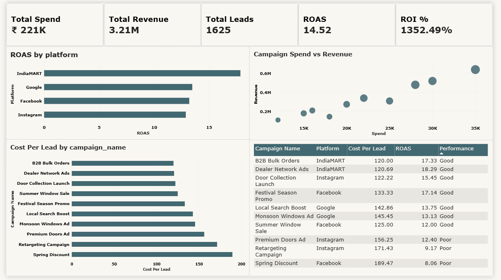

# Marketing Campaign Performance & ROI Analysis

An end-to-end marketing analytics project using **MySQL and Power BI** to evaluate 10 digital marketing campaigns across Facebook, Instagram, Google, and IndiaMART.

The project explores campaign efficiency, lead generation, conversion performance, platform comparisons, and return on ad spend (ROAS), then translates the findings into budget-allocation recommendations.

> **Dataset disclaimer:** This project uses illustrative sample data modelled around a UPVC doors and windows business context. The figures are not verified company financial results or proof of actual campaign performance.

## Dashboard Preview



The Power BI dashboard contains three pages:

1. **Executive Overview** – Overall KPIs, campaign performance, spend and revenue.
2. **Platform Deep Dive** – Platform comparisons, lead conversion and campaign-start-month analysis.
3. **Campaign Efficiency** – CPL classifications, campaign rankings and budget recommendations.

Dashboard documentation and screenshots are available in the `powerbi_dashboard` folder.

## Business Problem

A UPVC doors and windows business needs to understand how its digital marketing campaigns perform across multiple advertising platforms.

The analysis focuses on questions such as:

- Which platform generates the most revenue relative to advertising spend?
- Which campaigns generate leads at a lower cost?
- Which campaigns convert leads into customers more effectively?
- How do platforms compare in terms of campaign efficiency?
- Where could the business review or reallocate its marketing budget?

  > **Data note:** This project uses a sample dataset (included in `01_database_setup.sql`) structured like the campaigns of a UPVC manufacturing business.

## Project Objectives

- Calculate Cost Per Lead (CPL) and Cost Per Acquisition (CPA).
- Calculate Return on Ad Spend (ROAS).
- Compare marketing performance across platforms.
- Identify high- and low-performing campaigns.
- Analyse the impressions-to-conversions funnel.
- Evaluate campaign revenue contribution.
- Develop rule-based budget recommendations.

## Tools & Technologies

| Tool | Application |
|---|---|
| MySQL | Data storage, validation and analysis |
| Power BI | Interactive dashboard |
| DAX | Measures and KPI calculations |
| Power Query | Data preparation and transformation |

## Dataset Overview

The dataset contains 10 illustrative marketing campaigns.

**Database:** `marketing_db`

**Table:** `campaigns`

| Column | Description |
|---|---|
| campaign_id | Unique campaign identifier |
| campaign_name | Campaign name |
| platform | Advertising platform |
| start_date | Campaign start date |
| end_date | Campaign end date |
| spend | Advertising expenditure |
| impressions | Total ad impressions |
| clicks | Total clicks |
| leads | Leads generated |
| conversions | Recorded conversions |
| revenue | Revenue attributed to the campaign |

**Platforms included:** Facebook, Instagram, Google and IndiaMART.

## Key Metrics

| Metric | Formula | Purpose |
|---|---|---|
| CPL | Spend / Leads | Cost of generating a lead |
| CPA | Spend / Conversions | Cost per recorded conversion |
| ROAS | Revenue / Spend | Revenue generated per unit of ad spend |
| CTR | Clicks / Impressions × 100 | Click-through rate |
| Click-to-Lead Rate | Leads / Clicks × 100 | Lead generation efficiency |
| Lead-to-Conversion Rate | Conversions / Leads × 100 | Conversion efficiency |

**Financial interpretation:** The project also calculates `(Revenue − Ad Spend) / Ad Spend × 100`. This is a revenue-versus-ad-spend measure, not net profit ROI, because product costs, salaries and other operating expenses are not included.

## Key Findings

The following results are calculated from the illustrative sample dataset.

### 1. Platform Performance

| Platform | Spend | Revenue | Leads | ROAS | Weighted CPL |
|---|---:|---:|---:|---:|---:|
| IndiaMART | ₹65,000 | ₹11,60,000 | 540 | 17.85 | ₹120.37 |
| Google | ₹36,000 | ₹4,85,000 | 250 | 13.47 | ₹144.00 |
| Facebook | ₹61,000 | ₹8,05,000 | 425 | 13.20 | ₹143.53 |
| Instagram | ₹59,000 | ₹7,60,000 | 410 | 12.88 | ₹143.90 |
| **Total** | **₹2,21,000** | **₹32,10,000** | **1,625** | **14.52** | **₹136.00** |

### 2. Campaign-Level Findings

- **Dealer Network Ads (IndiaMART)** has the highest campaign ROAS at approximately 18.29.
- **B2B Bulk Orders (IndiaMART)** follows with a ROAS of approximately 17.33.
- **Spring Discount (Facebook)** has the highest CPL at approximately ₹189.47.
- IndiaMART has the lowest weighted CPL among the four platforms in this sample.

### 3. Campaign Efficiency

Using illustrative CPL thresholds:

- Excellent: CPL below ₹100
- Good: CPL from ₹100 to ₹150
- Average: CPL above ₹150 and up to ₹200
- Poor: CPL above ₹200

The SQL analysis uses a slightly different classification for its labels: above ₹150 to ₹200 is Average, and above ₹200 is Poor. The dashboard's categories should use the same thresholds before presenting a combined result.

## Business Recommendations

Based on the sample results:

1. **Evaluate IndiaMART:** Its sample ROAS and weighted CPL are strongest. Further testing could assess whether additional budget maintains performance.
2. **Review Spring Discount:** Its CPL is relatively high compared with the other campaigns. Investigate audience targeting and creative performance.
3. **Compare Google, Facebook and Instagram:** Their weighted CPL values are similar, so conversion quality and ROAS can help guide further testing.
4. **Track the complete funnel:** Monitor impressions, clicks, leads and conversions to identify where potential customers drop off.
5. **Validate profitability before reallocating budget:** ROAS alone does not account for product costs, margins or operating expenses.

These are exploratory recommendations based on sample data, not proven outcomes.

## SQL Concepts Demonstrated

- SELECT, WHERE and ORDER BY
- Aggregate functions: SUM, COUNT
- GROUP BY and HAVING
- CASE WHEN conditional classification
- NULLIF for safe division
- Common Table Expressions (CTEs)
- Window functions: RANK and LAG
- Date functions and monthly grouping
- Subqueries
- Business KPI calculations

## Repository Structure

```text
marketing-roi-analysis/
│
├── 01_database_setup.sql
├── 02_analysis_queries.sql
├── README.md
│
└── powerbi_dashboard/
    ├── Dashboards.pbix
    ├── page1_campaigns.png
    ├── page2_campaigns.png
    ├── page3_campaigns.png
    └── README.md
```

## How to Run the Project

1. Install MySQL 8.0 or later.
2. Open MySQL Workbench.
3. Run `01_database_setup.sql` to create the database, table and sample records.
4. Run `02_analysis_queries.sql` to perform the analysis.
5. Open `Dashboards.pbix` in Power BI Desktop to explore the dashboard.

## Limitations

- The dataset contains only 10 illustrative campaigns.
- Campaign revenue is provided as a campaign-level total, not daily revenue.
- Monthly analysis groups campaigns by their start month; it does not represent actual monthly revenue recognition.
- ROAS does not account for product costs or other operating expenses.
- Budget thresholds are illustrative business rules, not universal marketing benchmarks.
- The dataset does not include customer-level attribution or channel overlap.

## AI-Assisted Project Development

AI tools, including ChatGPT, were used to support SQL query development, troubleshooting, explanations and documentation. The project is intended to demonstrate understanding of the analytical methods and the ability to interpret the outputs, rather than to claim that every query was independently authored.

## Author

**Yusuf Baig** — Data Analyst | SQL · Power BI · Excel | Based in Dubai, UAE
Data Analyst | Open to opportunities in Dubai, UAE

- [LinkedIn](https://www.linkedin.com/in/yusuf-baig-783906210/)
- [GitHub](https://github.com/Yusufbaig2001)
