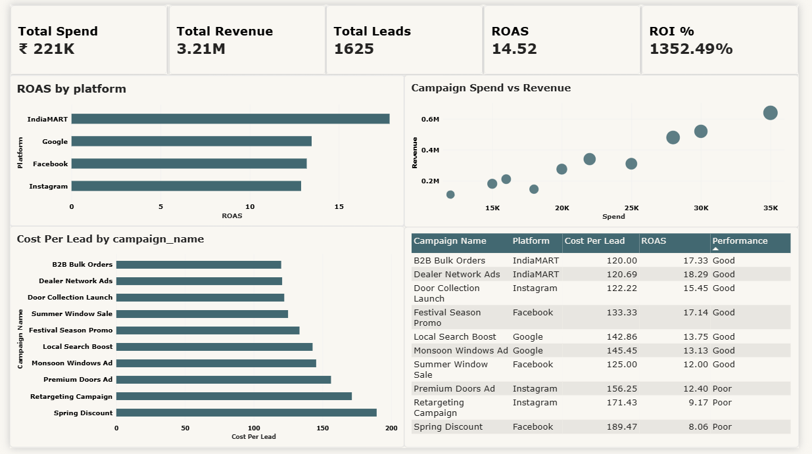
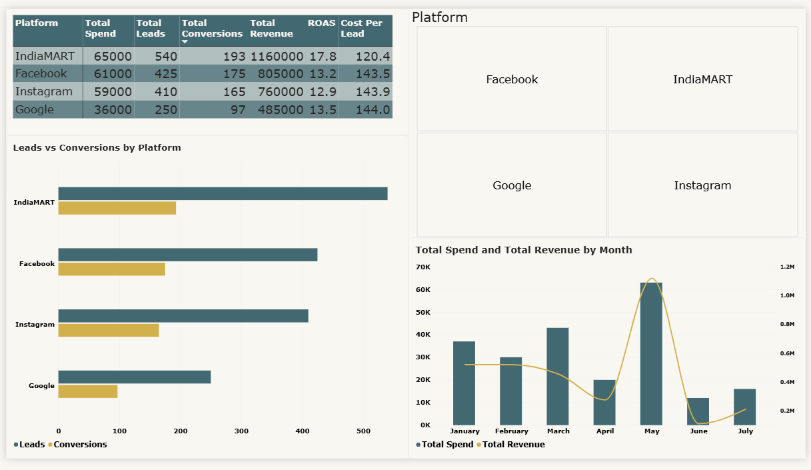
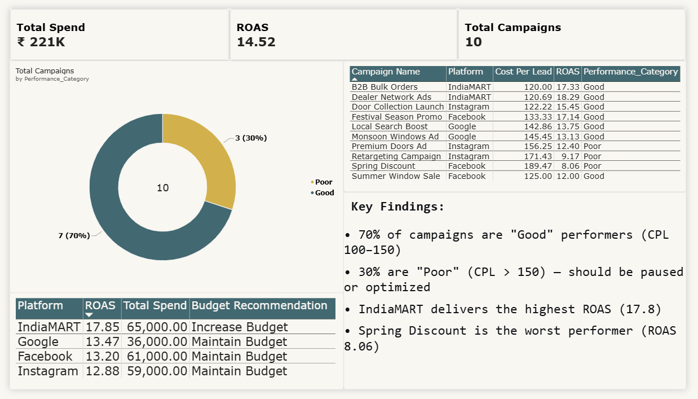

# Power BI Dashboard — Marketing Campaign Performance

An interactive 3-page Power BI dashboard analysing 10 illustrative marketing campaigns across Facebook, Instagram, Google and IndiaMART.

## Dashboard Pages

### Page 1 — Executive Overview



**Key metrics:**
- Total Ad Spend: ₹221,000
- Total Revenue: ₹3,210,000
- Total Leads: 1,625
- Total Conversions: 630
- Overall ROAS: 14.52

**Visuals:** Platform ROAS, campaign spend versus revenue, cost per lead by campaign, and campaign performance overview.

### Page 2 — Platform Deep Dive



**Key observations from the sample data:**
- IndiaMART has the highest platform ROAS (17.85).
- IndiaMART also has the lowest weighted CPL (approximately ₹120.37).
- Google has a ROAS of 13.47.
- Facebook has a ROAS of 13.20.
- Instagram has the lowest platform ROAS (12.88).

**Visuals:** Platform comparison, leads versus conversions, and campaign-start-month trends.

### Page 3 — Campaign Efficiency



**Key observations:**
- Dealer Network Ads (IndiaMART) has the highest campaign ROAS (approximately 18.29).
- Spring Discount (Facebook) has the highest CPL (approximately ₹189.47).
- Seven campaigns have CPL between ₹100 and ₹150.
- Three campaigns have CPL above ₹150 and up to ₹200.

**Visuals:** Campaign efficiency classification, campaign ranking, and platform budget recommendations.

## Campaign Efficiency Classification

The SQL analysis uses these illustrative CPL categories:

| CPL | Classification |
|---|---|
| Below ₹100 | Excellent |
| ₹100–₹150 | Good |
| Above ₹150–₹200 | Average |
| Above ₹200 | Poor |

The dashboard's calculated categories should use these same thresholds.

## Technologies Used

- Power BI Desktop
- DAX
- Power Query

## Important DAX Measures

```dax
Total Spend =
SUM(campaigns[spend])

Total Revenue =
SUM(campaigns[revenue])

Total Leads =
SUM(campaigns[leads])

Total Conversions =
SUM(campaigns[conversions])

Cost Per Lead =
DIVIDE([Total Spend], [Total Leads])

Cost Per Acquisition =
DIVIDE([Total Spend], [Total Conversions])

ROAS =
DIVIDE([Total Revenue], [Total Spend])

Revenue Less Ad Spend % =
DIVIDE(
    [Total Revenue] - [Total Spend],
    [Total Spend]
)

Budget Recommendation =
SWITCH(
    TRUE(),
    [ROAS] > 15, "Increase Budget",
    [ROAS] >= 10, "Maintain Budget",
    "Review / Reduce Budget"
)
```

**Calculated column for campaign efficiency:**

```dax
Campaign Efficiency =
VAR CPL =
    DIVIDE(campaigns[spend], campaigns[leads])
RETURN
    SWITCH(
        TRUE(),
        ISBLANK(CPL), "Not Available",
        CPL < 100, "Excellent",
        CPL <= 150, "Good",
        CPL <= 200, "Average",
        "Poor"
    )
```

## Files in This Folder

| File | Description |
|---|---|
| `Dashboards.pbix` | Power BI source file |
| `page1_campaigns.png` | Executive Overview |
| `page2_campaigns.png` | Platform Deep Dive |
| `page3_campaigns.png` | Campaign Efficiency |

## Important Notes

- Dataset values are illustrative sample figures, not verified company results.
- ROAS measures revenue generated per unit of advertising spend.
- Revenue less ad spend is not net profit or true business ROI.
- Monthly analysis groups campaigns by their start month; it does not represent actual monthly revenue recognition.
- Budget recommendations are based on illustrative ROAS thresholds and should be validated against actual profit margins.

## Author

**Yusuf Baig** — Aspiring Data Analyst | Open to roles in Dubai, UAE

- [LinkedIn](https://www.linkedin.com/in/yusuf-baig-783906210/)
- [GitHub](https://github.com/Yusufbaig2001)
